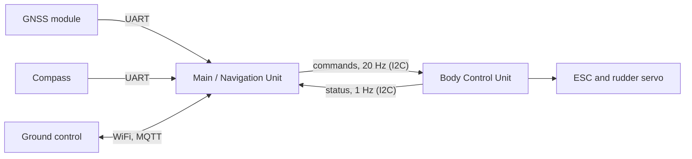

## Main / Navigation Unit

The main unit is the boat's autopilot. It knows where the boat is and which way it points,
takes a destination from the shore, and tells the
[Body Control Unit](../body_control_unit_rpipico_mp/index.md) what throttle and rudder to
apply. It solves four problems:

- **Sensing:** reads position, speed and course from the GNSS module, and heading from the
  compass, and keeps track of how fresh each reading is.
- **Deciding:** 20 times a second it chooses throttle and rudder. Anything it can't trust
  (stale heading, no GPS fix, no destination) means neutral.
- **Talking to the shore:** receives commands and sends telemetry once a second over WiFi
  and MQTT.
- **Staying up:** a failing sensor, link or task is contained, counted and recovered from,
  without stopping the control loop.

- Board: Seeed XIAO ESP32-S3 (8 MB PSRAM), MicroPython 1.29
- Sources: [`electronics/main_controller_esp32_mp/`](.)
- Ground side: [`software/ground_control_srteamlit/`](../../software/ground_control_srteamlit/)

## Connections

| Header pin | GPIO | Role |
|---|---|---|
| D0 / D1 | 1 / 2 | Compass UART (TX / RX), 3 Mbaud. D0 goes to the compass's SCL pin, D1 to its SDA pin |
| D4 / D5 | 5 / 6 | I2C SDA / SCL to the Body Control Unit (controller side, 100 kHz, target at `0x31`) |
| D6 / D7 | 43 / 44 | UART console (TX / RX, 115200): REPL, logs and uploads |
| D9 / D10 | 8 / 9 | GNSS UART (TX / RX), 9600 baud |
| on board | 21 | Heartbeat LED |

- **Compass:** BNO08x (BNO080/085/086). It runs in its UART mode (breakout pin PS1 to 3.3 V,
  PS0 to ground), because its I2C does not work reliably with the ESP32-S3.
- **GNSS:** Quectel L76K, one fix a second.

The pins are set per board in `BOARD_PINS` in [`controller.py`](controller.py). The original
ESP32 WROOM dev board is still listed there, but has not been tried since the move to the XIAO.

## How it works

One loop runs a set of fixed-rate tasks in turn. WiFi and MQTT run in their own threads, so
a network stall can't hold the loop up.

| Task | Every | What |
|---|---|---|
| control | 50 ms | Decide throttle and rudder, send them to the Body Control Unit |
| compass | 100 ms | Read the heading |
| gps | 100 ms | Read what the GNSS module has sent |
| bcu_status | 1 s | Read the Body Control Unit's status (mode, battery, failsafe, outputs) |
| mqtt | 1 s | Handle received commands, queue a telemetry message |
| report | 1 s | Heartbeat LED, housekeeping |

- **The control decision** checks health first. The heading has to be newer than 500 ms and
  the GPS fix valid; otherwise the command is neutral, with the reason in telemetry. With
  both good and a destination set, it asks the navigation code what to do.
- **Navigation** ([`gnc.py`](gnc.py)) is a simple first version. It converts the offset to
  the destination into metres, gets the distance and the course to steer, and steers with
  rudder in proportion to the course error, easing the throttle as the rudder grows. Inside
  4 m of the destination it stops. Its open items are listed at the top of the file; its
  maths can be checked on a desktop with [`test_gnc.py`](test_gnc.py).
- **The Body Control Unit has the last word.** It only follows these commands while the
  transmitter's mode switch is on autonomous, and it goes to neutral by itself if they stop
  for 750 ms.
- **Compass calibration** is learned by the chip as the boat is moved around, and saved to
  the chip once it reaches its highest accuracy, so later starts begin calibrated. How to
  calibrate, and the mounting offset, are described at the top of [`compass.py`](compass.py).

## Staying up

- **Tasks are isolated.** An error in one is counted and logged, and the others keep their
  schedule. A task that falls behind skips the missed runs instead of bursting to catch up.
- **Compass:** if headings stop, its reports are re-enabled first, which keeps its
  calibration. Only if that doesn't help is it re-initialised, at most every 10 s. A missing
  compass doesn't stop the boot.
- **GNSS:** if the module goes quiet, it is re-initialised, at most every 10 s.
- **I2C:** if commands to the Body Control Unit keep failing, the bus is freed and
  re-created, backing off if that doesn't help.
- **Network:** WiFi and the broker connection are retried for as long as they are down. A
  missing configuration only disables MQTT.
- **Watchdog:** in production mode (a `production` file on the board) an 8 s hardware
  watchdog resets the board if the loop stops. The board first holds neutral for 3 s, which
  is the window to get in and upload.
- **Last resort:** anything that escapes all of this is caught in [`main.py`](main.py),
  which commands neutral and resets the board.

## Shore link

Over MQTT with TLS, on two topics (set in [`mqtt.py`](mqtt.py)):

- **Commands** to the boat, as JSON:
  - `{"cmd": "destination", "lat_e7": ..., "lon_e7": ...}` sets where to go. Coordinates are
    whole numbers of degrees × 10⁷, as in telemetry.
  - `{"cmd": "clear_destination"}` resets the destination, and the boat holds neutral.
  - The destination is not kept across a restart.
- **Telemetry** from the boat, once a second: a message number, uptime, the control decision
  and its reason, heading and compass accuracy, the GPS fix, the Body Control Unit's status,
  the destination and what navigation made of it, error counters for every task and link,
  WiFi signal strength and memory.

