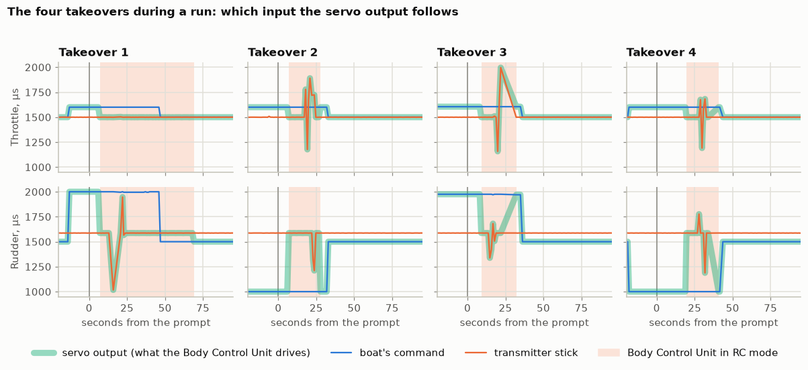
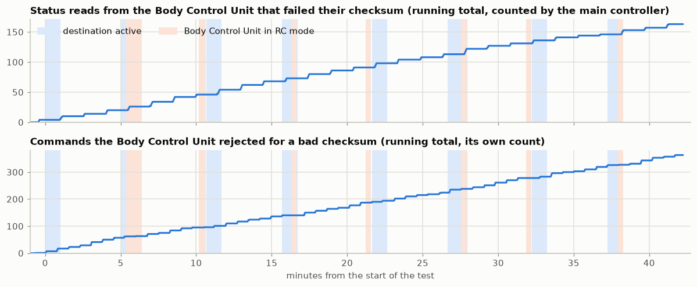

# Mission 3 — Control test

A test on dry land, before the boat goes on the water: check that the electronics
are reliable, and that control can be switched back to RC at any moment.

Details, plots and code: [data_analytics/analytics.ipynb](data_analytics/analytics.ipynb).

**In short:** the control chain works. Every command reached the boat, the Body Control Unit
executed each one exactly, every switch to RC gave the operator full control, and
no telemetry was lost. The GPS objective was not answered, because the boat was
indoors. One thing to fix came out of it: the link between the two boards loses
some data in regular bursts.

## Objectives

1. **Electronics** — no faults for the whole duration of the test.
2. **RC takeover** — switching to RC mode works at any time.
3. **Telemetry** — received reliably, without gaps.
4. **GPS** — readings show no large inaccuracies.
5. **Internet access point** — stays active throughout.

## Setup

| | |
|---|---|
| Main controller | Seeed XIAO ESP32-S3, [firmware](../../electronics/main_controller_esp32_mp/) |
| Body Control Unit | Raspberry Pi Pico ([details](../../electronics/body_control_unit_rpipico_mp/index.md)), on I2C at 100 kHz |
| Compass | BNO08x on a UART |
| GNSS module | Quectel L76K on a UART, 1 Hz |
| Link | WiFi access point carried on the boat, MQTT over the internet |
| Battery | 2S pack, 8.26 V at the start |
| Location | **Indoors**, boat standing on dry land, propeller free to spin |

## Procedure

The test was run by [src/control_test.py](src/control_test.py), which sends the
commands on a schedule, prompts the operator, and logs everything with timestamps.

- **Four autonomous sections** of two 5-minute cycles each. In a cycle the boat is
  sent a destination 50 m away (north, east, south, west in turn), the stop follows
  one minute later, then nothing until the cycle ends.
- **A takeover during every second run:** while the boat is driving, the operator
  switches to RC, uses the sticks, and switches back.
- **An RC test between sections,** with the boat idle.

| | Planned | Performed |
|---|---|---|
| Duration | 58 min | 42 min |
| Destinations sent | 8 | 8 |
| Takeovers during a run | 4 | 4 |
| RC tests between sections | 3, about 6 min each | 3, about 24 s each |

The test is shorter than planned only because the RC tests were kept short, on
purpose. Every 5-minute cycle ran its full length.

## Results

| Objective | Result | Evidence |
|---|---|---|
| 1. Electronics | Pass, with a finding | No restarts, task errors or recoveries on either board. But 6.3 % of status reads from the Body Control Unit and 0.7 % of commands to it fail their checksum |
| 2. RC takeover | Pass | All 7 switches to RC took effect, 4 of them during a run. Outputs matched the sticks exactly |
| 3. Telemetry | Pass | 2,597 of 2,597 messages received, in order. Longest wait between two: 2.2 s |
| 4. GPS | Not answered | The boat was indoors (see below) |
| 5. Access point | Pass | One WiFi connect and one broker connect for the whole test, no link errors |
| Destinations picked up | Pass | 8 of 8 destinations and 8 of 8 stops confirmed by the boat, within 2 s |

### RC takeover

In autonomous mode the servo outputs matched the boat's command exactly, and in
RC mode they matched the transmitter exactly, including the four switches made
while the boat was commanding 20 % throttle and full rudder. The Body Control Unit never went
to failsafe and never lacked a fresh command.

The thick band is what the Body Control Unit drives the servo with. It lies on the boat's
command until the shaded region (Body Control Unit in RC mode) starts, and on the transmitter
stick inside it.

The delay from the prompt to RC mode (7 to 20 s) is the operator's reaction time,
not the electronics. Telemetry is once a second, so the switch itself is not
timed more finely than that.

### The link between the two boards

Nothing failed, but the I2C link between the main controller and the Body Control Unit is not clean:

| Direction | Sent | Failed their checksum | Share |
|---|---|---|---|
| Status reads from the Body Control Unit (1 per second) | 2,597 | 163 | 6.3 % |
| Commands to the Body Control Unit (20 per second) | 51,920 | 363 | 0.7 % |

The errors keep a rhythm: status reads fail for a few seconds about every 90
seconds, and commands are rejected in a burst about every 45 seconds.

Electrical noise would not keep time like that. Two boards each running their own
fixed-rate loop and drifting slowly past each other would, which points at one
board reading or writing while the other is half-way through an update. That is
a reading of the pattern, not something this test proves.

**The dropped messages did not trigger the failsafe, and were not close to it.**
Every failed message was caught by its checksum, and the next one replaced it. The
Body Control Unit goes to failsafe only after 750 ms without a valid command, which
at 20 commands a second means about 15 in a row would have to be lost. In the worst
second of the test 7 of the 20 commands were rejected, and in 9 seconds out of 10
none were. In all 2,434 status samples it reported a fresh command and no failsafe.
The cost was limited to the telemetry: a failed status read leaves that second's
message without Body Control Unit data.

### GPS

**The boat was indoors, so this objective is not answered.** Indoors the position
wandered by up to 10 m, with 95 % of fixes within 6 m of the median. Outdoors,
[mission 2](../2_gps_precision_testing/index.md) measured the same module at 95 %
within 1.7 m on dry land and about 0.5 m afloat, and those remain the reference.

One thing does carry over: the receiver reported 10 or more satellites and an
HDOP around 1 the whole time, much as it did outdoors. Its quality figures did not
show that the fixes were poor, so they cannot be used to decide when to trust one.

### Navigation

Not an objective, but the runs exercised the navigation code for the first time
in the live loop.

- **Outputs were as designed** for a boat pointing north: straight ahead at 40 %
  throttle for the northern destinations, full rudder at 20 % for east and west.
- **Rotation check.** During the last southern run the operator turned the boat
  by hand, and the rudder command went from one stop to the other and back as the
  heading crossed the reciprocal bearing. The rudder reacted as expected.
- **A knife edge near dead astern.** That same behaviour means a target almost
  directly behind the boat can throw the rudder from stop to stop on a small
  change in heading.

## Operator notes

- The propeller spun during the runs, and the servo and motor followed the sticks
  whenever they were moved.
- The access point was checked and repositioned around minute 14; it shows as the
  only dip in WiFi signal.
- In takeover 1 the switch was left on RC past the end of the run, and takeover 4
  was slow to start. Both were operator mistakes.

## What this test did not cover

- **GPS accuracy,** for the reason above.
- **The access point's internet connection away from this spot.** The WiFi hop is
  on board and does not change with distance; the access point's own uplink does.
- **Recovery.** Nothing failed, so reconnecting after a dropout was not exercised.
- **Load.** The propeller ran in air: the battery dropped only 48 mV in 42 minutes.
- **Motion.** Apart from one hand rotation the boat stood still.

## Takeaways for the project

| | |
|---|---|
| RC takeover | Ready. All 7 switches gave the operator exact control, including 4 made while the boat was driving |
| Telemetry | Ready at this location. Every message arrived, in order, with no reconnects. Not yet tested: recovery after a dropout, and the access point's uplink away from shore |
| Commands | Ready. All 16 were picked up within 2 s and executed exactly |
| Navigation to Body Control Unit link | Find and fix the cause of the periodic checksum failures |
| GPS quality figures | Satellite count and HDOP do not flag poor fixes; do not gate navigation on them alone |
| Arrival logic | Needs hysteresis (already an open item, and mission 2's outdoor drift calls for it too) |

## Next steps

- Investigate the I2C bursts (timing between the two boards' loops).
- Repeat the stationary GPS part outdoors, with the access point on board, to see
  whether it affects the fixes.
- Test recovery: switch the access point off for a while during a run.
