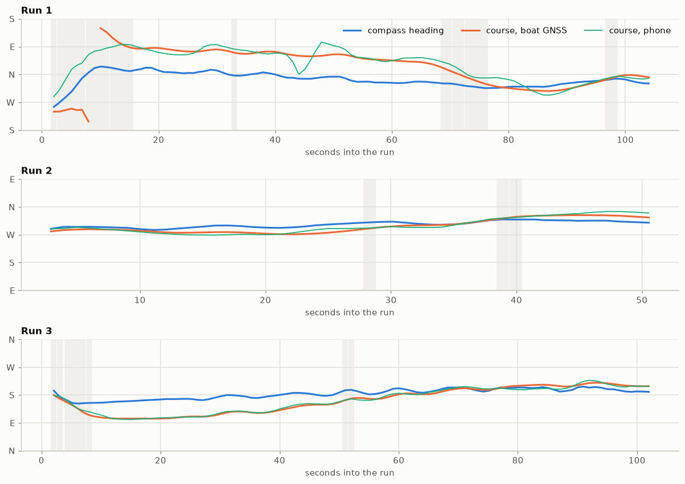

# Mission 4 — Waypoint navigation #1

The first time the boat navigated on its own: three runs, each to a destination sent from
ground control, 45–66 m away.

Details, plots and code: [src/analytics.ipynb](src/analytics.ipynb).

**In short:** the boat reached all three destinations, and its GPS agreed with a reference
phone to within a few metres. The compass did not: depending on the direction it was off by
up to about 70°. The steering was stable, but held a steady 10° off course because the
autopilot's rudder neutral is not the boat's straight-ahead position.

## Objectives

1. **Heading** — is the compass accurate?
2. **Rudder** — does the steering stay balanced, without weaving?
3. **GPS** — does the boat's GPS agree with a reference?

## Setup

| | |
|---|---|
| Firmware | Main controller as of mission 3's deployment, without the fixes listed there |
| Navigation | Simple first version: steer to the destination's bearing, stop within 4 m |
| Logging | Telemetry recorded by the [MQTT logger](../../software/mqtt_logger/) |
| Reference | A phone running a GPS logger, carried with the boat |

## Results

| Run | Distance | Time to arrive |
|---|---|---|
| 1 | 53 m | 106 s |
| 2 | 45 m | 53 s |
| 3 | 66 m | 104 s |

All three ended inside the 4 m arrival radius, at about 0.8 m/s.

| Objective | Result |
|---|---|
| 1. Heading | **Not accurate.** Off by between about −70° and +60°, depending on the direction of travel |
| 2. Rudder | **Stable, but off-centre.** No weaving; a steady 9–12° course error from the rudder trim |
| 3. GPS | **Reliable.** Within 1.4–4 m of the phone (median per run), about 3 m to the south |

### GPS

The two tracks follow the same route and both end inside each arrival radius. They run
parallel a few metres apart, with the boat's fix generally about 3 m south of the phone's: a
steady offset between the two receivers rather than noise.

The GPS module's own course-over-ground output froze at this speed (one value in 741 of
1,246 messages), so the course has to be worked out from positions. The boat's GPS and the
phone agree on that course to within a few degrees.

### Compass

The boat moves bow first, so the direction it travels (from GPS) should match the direction
the compass says it points.

Each panel is centred on that run's general direction; the shaded stretches are turns or slow
moments, left out of the numbers.

- **The error depends on the direction.** It is small heading north-west (run 2) and
  south-south-west (end of run 3), and very large heading east-north-east (run 1, about −65°)
  and south-east (start of run 3, about +55°). Only about a quarter of the samples are within
  10°.
- **The compass does not follow the boat's turns.** In run 1 it turned with the boat but about
  60° behind; in runs 2 and 3 it moved only about a third as far as the boat did. That points
  to a magnetic field carried on the boat (motor, battery or their wiring) overwhelming the
  Earth's.
- **It does turn the right way**, so the direction fix from mission 3 is correct.
- **The chip's own calibration figure (2–3 of 3) gave no warning.**

### Rudder

- **No weaving.** The course error never swung back and forth and the rudder never reversed
  while holding a course. From each new destination the boat was within 15° of its course in 3
  seconds (9 in run 1, which started about 160° off and from rest).
- **Moderate margin.** The boat turns about 0.28°/s per % of rudder, about 3 seconds after the
  command. With the autopilot's gain that gives a response time of about 3 s and a phase margin
  of about 36° (45–60° is comfortable): the gain could rise only about 1.7× before weaving.
- **A steady 9–12° course error in every run.** The boat goes straight at about +12 % rudder,
  while the autopilot's neutral is 0 % (1500 µs); the transmitter's rudder trim rests at
  1587 µs, the same direction. A proportional controller can only hold that rudder by holding
  an error, which also explains part of the curved paths.

## Findings

- The navigation chain works: the boat reached every destination it was sent.
- The GPS is good enough to navigate by, but its own course output is not usable at this speed.
- The compass is the weak link. Its error is far too large and too dependent on direction to
  correct with an offset or a deviation curve.
- The steering is stable, but its neutral is off-centre.
- **Once the heading is correct, the steering will become more aggressive.** The compass
  under-reported each turn, so the controller saw less of it than really happened. Correcting
  that raises the effective gain by more than the 1.7× margin.

## Remediation plan

1. **Rudder neutral:** set the autopilot's neutral to the boat's straight-ahead position (about
   1587 µs, if the transmitter trim is right).
2. **Compass:** with the boat still, watch the heading as the motor is switched on and the
   throttle changed, to find what disturbs it. Then move the compass away from the motor,
   battery and power wiring, and recalibrate it in place.
3. **Heading source:** blend the gyro (the compass chip's game rotation vector, which ignores
   magnetic fields) with the course from GPS positions whenever the boat runs straight at a
   usable speed. The approach is described at the end of the notebook.
4. **Course on board:** compute the course from positions in the navigation code instead of
   using the GPS module's frozen output.
5. **Re-tune the rudder gain** after the heading source changes, and check again at higher
   throttle, before going far from shore.
6. **Next mission:** repeat with full slow circles in both directions, so the compass is checked
   at every heading.
