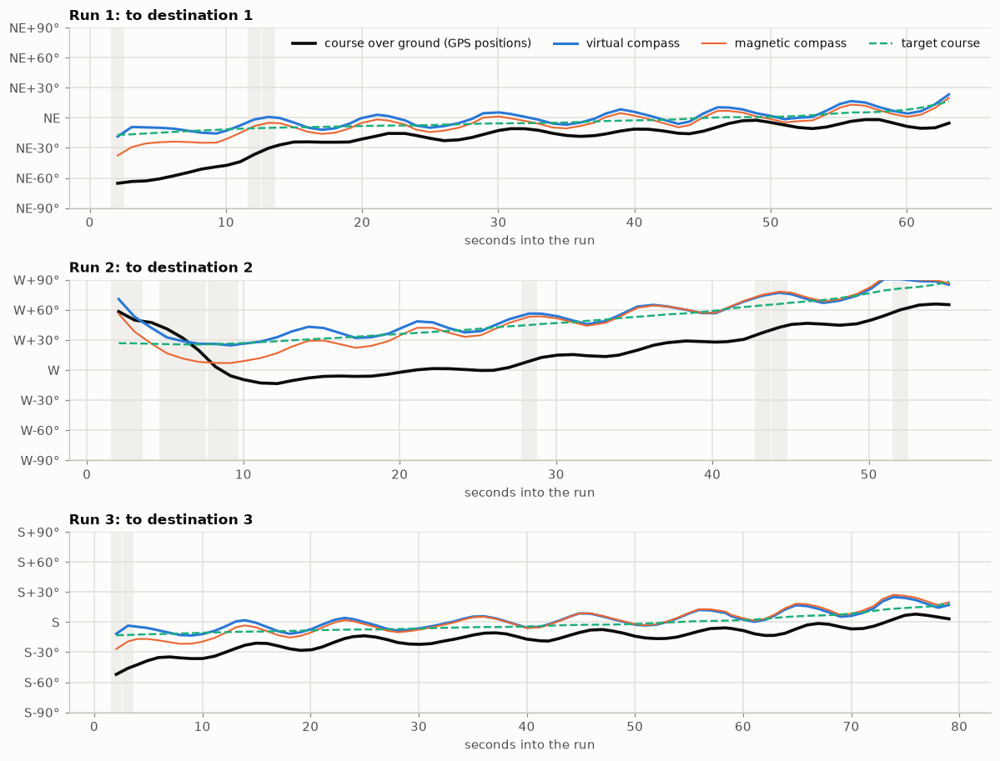

# Mission 5 — Waypoint navigation #2

The second autonomous navigation test, after the fixes from mission 4: the same three
destinations, now steered by the new virtual compass and with the rudder trimmed.

Details, plots and code: [src/analytics.ipynb](src/analytics.ipynb).

**In short:** considerably better than mission 4. The boat reached all three destinations, and
two of the three tracks were much straighter: at most about 6 m off the straight line instead of
25 m, and only 3–5 % longer than it instead of 30–50 %. The leg to destination 2 still curved, as
much as in mission 4. The cause is the gyro, not the autopilot or the GPS: on the water it
drifted by about 1°/s, and the virtual compass's GPS correction can only hold a drift like that
at a lag of 15–40°. The rudder trim turned out to be slightly too far right.

## Objectives

1. **Heading** — does the virtual compass (gyro, corrected by the magnetic compass and the GPS
   track) give a heading the boat can steer by?
2. **Rudder** — with the trim set, does the boat run straight without a standing course error?
3. **Navigation** — does the boat reach the same three destinations as mission 4, on straighter
   tracks?

## Setup

| | |
|---|---|
| Firmware | Main controller with the virtual compass (`virtual_compass.py`) and the rudder trim (`rudder_center_us` 1587 µs, +17 %) |
| Navigation | As in mission 4: steer to the destination's bearing, stop within 4 m |
| Destinations | Mission 4's three, numbered the same (1, 2, 3) |
| Logging | Telemetry recorded by the [MQTT logger](../../software/mqtt_logger/) |
| Reference | None this time (no phone track) |

Five destinations were sent that day. The analysis uses the middle three, which are mission 4's
destinations 1–3 in order (`data/mqtt_20261025_points_2-4.jsonl`, next to the full log). The
logs hold the boat's real positions, so they are kept out of the repository; the charts show
metres from the first fix instead.

## Results

| Run | Distance | Time to arrive | Distance at arrival |
|---|---|---|---|
| 1 | 52 m | 66 s | 3.4 m |
| 2 | 42 m | 58 s | 3.4 m |
| 3 | 65 m | 81 s | 3.3 m |

All three were driven by the autopilot from start to arrival, at about 0.8 m/s.

| Objective | Result |
|---|---|
| 1. Heading | **Not yet.** The virtual compass read 17° (runs 1 and 3) to 38° (run 2) clockwise of the real direction of travel, because the gyro drifted |
| 2. Rudder | **Better, slightly off.** The boat goes straight at about +12 %, not the +17 % set; the autopilot held about −4 % of rudder all the time |
| 3. Navigation | **Much straighter.** Every destination reached; runs 1 and 3 far straighter than in mission 4, run 2 about the same |

### Compared with mission 4

How far each track strayed from the straight line between where the run started and its
destination, and how much longer the path was than that line. The runs started from slightly
different places in the two missions, so these compare runs to the same destinations rather than
identical legs.

| Destination | Mission 4: max / mean off the line | Mission 5: max / mean off the line | Path longer than the line, mission 4 → 5 |
|---|---|---|---|
| 1 (about 53 m) | 26.0 / 13.4 m | **6.4 / 4.7 m** | 52 % → **5 %** |
| 2 (about 44 m) | 7.8 / 4.4 m | 9.3 / 5.4 m | 8 % → 11 % |
| 3 (about 65 m) | 25.0 / 14.5 m | **5.9 / 4.3 m** | 32 % → **2.5 %** |

The day's two runs left out of the analysis were in the same range (5–12 m at most off the
line).

### Heading

The boat moves bow first, so the direction it travels (worked out from GPS positions) should
match the heading it steers by.

- **The autopilot did its job.** It kept the virtual compass within 3–4° of the target course.
- **The virtual compass read too far right**, so the boat's real course ran to the left of the
  target. As the boat drifted off the line, the bearing to the destination kept swinging, and
  the track curved. Run 2 started worst, 48° out after the turn towards its destination.
- **The magnetic compass followed the boat's turns** this time, unlike in mission 4, but it read
  13–33° clockwise of the course, depending on direction. It hardly affects steering: the
  virtual compass only starts from it.

### The gyro

The virtual compass follows the gyro (the BNO08x's game rotation vector) and pulls towards the
GPS course by 5 % of the error a second. Under way on the autopilot, over 321 seconds:

| Source | Turned |
|---|---|
| Course from GPS positions | +348° |
| Magnetic compass | +368° |
| Gyro | **+620°** |

- **The gyro drifted by about +0.8°/s.** Against the magnetic compass it measures every turn
  correctly (scale 1.01) and adds a constant rate on top. It was ahead of the GPS course in 15 of
  16 twenty-second stretches.
- **The GPS correction worked as designed, but it can't remove a drift.** A correction
  proportional to the error holds a drift of *d* at a lag of *d* ÷ 0.05: about 16° here, what runs
  1 and 3 show.
- **The drift wandered.** It went from −1 to +1.5°/s over minutes, independent of the autopilot,
  the motor and the rudder. It also ran with the boat stopped on the water. It was zero whenever
  the boat was truly still.
- **The bench doesn't reproduce it.** Back on the bench, the gyro and the magnetic compass agree
  to within 0.15°/s with the boat still, heeled, with the rudder sweeping or jumping, with the
  motor running, and when turned or shaken by hand.

### Rudder

At the autopilot's neutral the boat turned right at about 4°/s, and it went straight at about
−5 % from there. So the boat's straight-ahead rudder is about +12 %, as mission 4 measured, not
the +17 % taken from the transmitter's trim. The proportional autopilot can only hold that
offset by holding a small course error, 3–4° here.

## Findings

- The navigation chain works: the boat reached every destination, and the GPS track is good
  enough to judge the heading by.
- The virtual compass and the rudder trim made the tracks considerably straighter than in
  mission 4: two of the three runs strayed at most about 6 m from the line, against 25 m.
- The remaining curves come from the heading the autopilot steers by, and that heading is off
  because the gyro drifted on the water, not because of the virtual compass's logic.
- The most likely cause is the BNO08x itself. With dynamic calibration on, it keeps re-learning
  its gyro's bias. That works when it is still and apparently goes wrong when it never quite is,
  as when floating or being carried. This is not proven yet.
- A small constant drift would be fine: at 0.2°/s the virtual compass's lag would be about 4°. A
  drift of 1°/s that keeps changing is not.
- The rudder trim should be +12 %.

## Changes after this mission

| Change | Where | Why |
|---|---|---|
| **Gyro dynamic calibration turned off** on the BNO08x (accelerometer and magnetometer calibration unchanged, still on) | `electronics/main_controller_esp32_mp/compass.py` | Stop the chip re-learning its gyro bias on the move; it keeps its saved gyro calibration, which was right on the bench |
| Rudder centre 1587 → 1560 µs (+17 → +12 %) | `config.py` on the main controller | Where the boat actually goes straight |

## Next

1. **Repeat the three runs** with these changes, and compare how far the gyro turns with how far
   the GPS course turns (the notebook's *Checking the conclusion* section, rerun on the new
   data). Within a few tenths of a degree per second would confirm the cause.
2. **If the gyro still wanders,** try the BNO08x's other rotation-vector reports (gyro-integrated,
   AR/VR-stabilised), or let the virtual compass learn the drift from the GPS corrections.
3. **Log faster** (gyro and magnetic yaw, roll and pitch at 5–10 Hz) to see when a drift starts
   and what the boat was doing.
