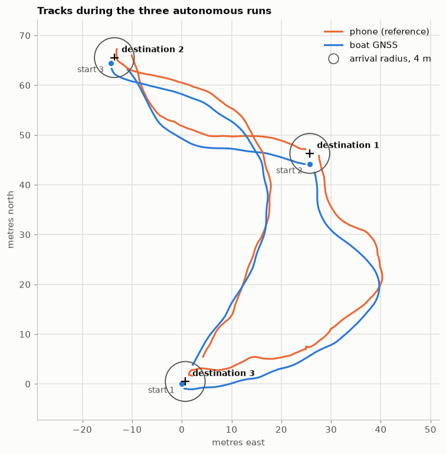
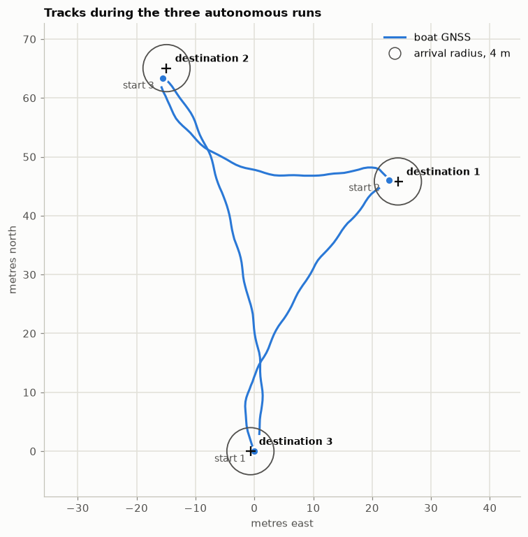
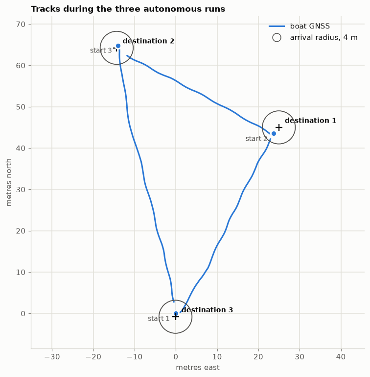

# Mission 6 — Waypoint navigation #3

The re-test after [mission 5](../5_waypoint_navigation_2/index.md)'s changes: the same three
destinations as missions 4 and 5.

Details, plots and code: [src/analytics.ipynb](src/analytics.ipynb).

**In short:** the tracks are now close to straight lines, at most 1.5 m off the direct line and
1–3 % longer than it. The gyro no longer drifts, so the virtual compass sits on the boat's real
direction of travel, and the autopilot steers where it means to.

## Setup

| | |
|---|---|
| Changes since mission 5 | The BNO08x's **gyro dynamic calibration turned off** (accelerometer and magnetometer calibration still on); rudder centre **1560 µs** (+12 %) instead of 1587 µs |
| Navigation | As in missions 4 and 5: steer to the destination's bearing, stop within 4 m |
| Destinations | Missions 4 and 5's three, numbered the same (1, 2, 3) |
| Logging | Telemetry recorded by the [MQTT logger](../../software/mqtt_logger/) |

The session sent four destinations; the analysis uses the last three, which are destinations 1–3
in order. The logs hold the boat's real positions and are kept out of the repository.

## Results

| Run | Distance | Time to arrive | Distance at arrival |
|---|---|---|---|
| 1 | 52 m | 61 s | 3.5 m |
| 2 | 43 m | 56 s | 3.2 m |
| 3 | 67 m | 87 s | 3.6 m |

All three were driven by the autopilot from start to arrival.

### Tracks across the three missions

| Mission 4 | Mission 5 | Mission 6 |
|---|---|---|
|  |  |  |
| Magnetic compass only; rudder neutral off-centre | Virtual compass and rudder trim; gyro drifting on the water | Gyro dynamic calibration off; trim at +12 % |

How far each track strayed from the straight line between where the run started and its
destination, and how much longer its path was than that line:

| Destination | Max off the line, M4 / M5 / **M6** | Mean off the line, M4 / M5 / **M6** | Path longer than the line, M4 / M5 / **M6** |
|---|---|---|---|
| 1 (about 52 m) | 26.0 / 6.4 / **1.5 m** | 13.4 / 4.7 / **0.6 m** | 52 / 5 / **1.4 %** |
| 2 (about 43 m) | 7.8 / 9.3 / **0.6 m** | 4.4 / 5.4 / **0.2 m** | 8 / 11 / **2.5 %** |
| 3 (about 66 m) | 25.0 / 5.9 / **1.3 m** | 14.5 / 4.3 / **0.5 m** | 32 / 2.5 / **1.4 %** |

## Findings

- **The cause found in mission 5 is confirmed.** The gyro's drift on the water came from the
  BNO08x re-learning its gyro bias on the move. With that calibration off, the drift dropped from
  about 1°/s to 0.05°/s.
- **The virtual compass works as designed.** Fed a gyro that doesn't drift, it matches the real
  direction of travel (median −0.1°), and the autopilot's tracks follow the direct line.
- **The rudder trim at +12 % holds.**
- Navigation to these three destinations is now accurate to a metre or two across the track.
